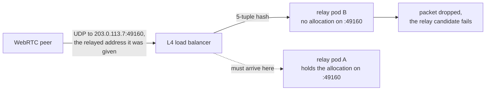

# Turnfleet

Turnfleet is a Kubernetes operator that runs
[coturn](https://github.com/coturn/coturn) as a fleet of TURN relays. Every
relay gets its own public relay identity: one address plus one disjoint port
range. A peer is handed the address the relay holds, so no load balancer sits in
the relay data path. A `TURNPool` declares the realm and shared secret, the
listeners, the relay port range and an addressing mode, and the operator places
the relays, renders a coturn configuration for each of them and reports what
they serve.

What a pool gives you:

* **Capacity in ports, per address.** One relay owns one address and the port
  range that comes with it. Replicas behind one address add processes instead of
  capacity, which is the bug this project removes.
* **Readiness from a real TURN `Allocate`.** A relay is ready when an allocation
  against it succeeds and returns the address and range the pool declares.
* **Per-relay `turn:` URIs.** Ready, non-draining relays are mirrored into the
  `<pool>-turn-uris` ConfigMap for your credential issuer to hand out.
* **Visible exhaustion.** Ports in use against ports owned, per relay, and a
  `CapacityPressure` condition when a relay is genuinely full.
* **Drain-aware rollouts.** A relay leaves `turnURIs` before its pod goes away,
  and its pod waits for its allocations to reach zero, or for `drainTimeout`.

## Why not replicas behind a Service

The common TURN deployment is N relay replicas behind one load-balanced public
IP. It cannot work. A TURN allocation is a public `(IP, port)` pair, and peer
traffic sent to that pair must reach the exact process holding the allocation.
Peer packets arrive from an arbitrary source port, so anything that hashes the
5-tuple (a Service, a cloud NLB, an L4 proxy) spreads them across the replicas:



The failure is silent, because every pod stays healthy. Turnfleet removes the
load balancer instead: one relay per public address, each owning a disjoint port
range, so a packet sent to `(address, port)` reaches the one process that owns
that port. A Kubernetes Service cannot express a port range at all, which is why
the relay range never travels through one. The full argument, including what a
cloud load balancer can and cannot do, is in
[`docs/capacity-model.md`](docs/capacity-model.md).

## Install

The released chart needs no checkout:

```sh
helm install turnfleet oci://ghcr.io/hazmi35/turnfleet-chart/turnfleet \
  --version 0.2.0 --namespace turnfleet-system --create-namespace
```

Installed without `--set`, that chart runs the released
`turnfleet-controller:0.2.0`, which is the image the release published, and the
release notes carry the chart's digest plus the commands that verify it.
`charts/turnfleet/values.yaml` lists what is configurable, including
`--set webhook.enabled=true` for the admission webhooks on a cluster that has
cert-manager. The chart carries the controller part only: the CRDs, the RBAC,
the manager, the metrics Service and, when you ask for them, the webhooks.
Relay pods never come from the chart.

Upgrading is one step more than installing. Helm installs the files under
`crds/` on the first install and never updates an existing CRD, so a release
that changes the schema needs `make helm-crds-apply` before `helm upgrade`.

### From a checkout

Prerequisites: Docker, Go (the version pinned in `go.mod`) and `make`. You also
need `kind` and `kubectl`, because `make kind-up` uses the `kind` binary from
your `PATH`.

```sh
make kind-up            # 1 control-plane + 3 workers labelled as relay nodes
make docker-build       # build both images for your platform
make load-images        # load them into the kind cluster
make install            # install the CRDs
make deploy             # deploy the controller (config/default: no admission webhooks)
```

`make helm-install` is the chart path through the same cluster. It passes the
image the Makefile just built and loaded, so it is the same dev image
`make deploy` runs, and it renders what `config/default` renders.
`make helm-lint` lints the chart, and `make helm-drift` renders the chart and
`config/` and fails when the two stop agreeing. Run `make install` with
`make deploy`, or `make helm-install`, never both, because Helm will not adopt
the objects kustomize created.

## Create a pool

`TURNPool` is the whole interface. A minimal `HostNetwork` pool with three
relays:

```yaml
apiVersion: turnfleet.hzmi.dev/v1alpha1
kind: TURNPool
metadata:
  name: demo
  namespace: default
spec:
  replicas: 3
  dataplane:
    image: coturn/coturn:4.18.0-r0@sha256:bbefd3e1fdfdc0d58770fe01b581fd8b00d9f3a5580d00acb77cf719a6bc78e3
  addressing:
    mode: HostNetwork
  relayPortRange:
    start: 49152
    end: 49200
  listeners:
    - name: turn
      protocol: udp
      port: 3478
  auth:
    realm: turnfleet.example.com
    secretRef:
      name: turn-shared-secret
      key: secret
```

```sh
kubectl --context kind-turnfleet -n default create secret generic turn-shared-secret \
  --from-literal=secret="$(openssl rand -hex 32)"
kubectl --context kind-turnfleet -n default apply -f pool.yaml
kubectl --context kind-turnfleet -n default get turnpools -w
kubectl --context kind-turnfleet -n default get cm demo-turn-uris -o jsonpath='{.data}'
```

`spec.replicas` counts relays. For each relay the operator creates a pod named
`<pool>-relay-<5-char hash of the relay identity>`. The pool also gets the
coturn configuration Secret (`<pool>-relay-config`) and the `<pool>-turn-uris`
ConfigMap, which lists the URIs of the ready, non-draining relays. The hash
comes from the relay identity, so the same identity always maps to the same pod
across restarts and failovers.

## Check a pool by hand

Run the probe the way an external client would:

```sh
kubectl --context kind-turnfleet -n default get secret turn-shared-secret \
  -o jsonpath='{.data.secret}' | base64 -d > /tmp/turn-secret
make build
bin/turnfleet-probe --uri "turn:<relay-address>:3478?transport=udp" \
  --secret-file /tmp/turn-secret --expect-address <relay-address> --json
```

The probe performs a real TURN `Allocate` and asserts that the relayed address
is the one the pool declares. To have the controller report that check instead
of leaving it in a terminal, apply the vantage runner next to the pool
(`config/vantage` is written for this `demo` pool):

```sh
kubectl --context kind-turnfleet -n default apply -f config/vantage/runner.yaml
kubectl --context kind-turnfleet -n default create job --from=cronjob/vantage-runner vantage-runner-once
kubectl --context kind-turnfleet -n default get turnpool demo \
  -o jsonpath='{.status.conditions[?(@.type=="ReachableFromVantage")]}'
```

The runner's pod is on the cluster's network, so this exercises the delivery
path and the condition, not external reachability. For that, the same command
has to run from outside the cluster
([`docs/adr/0015-vantage-result-delivery.md`](docs/adr/0015-vantage-result-delivery.md)).

`make test-e2e` runs the full suite against this cluster, including the
saturation and peer-policy cases.

## Addressing modes and capacity

Capacity is ports, not processes:

```
pool capacity (allocations) = distinct relay addresses × ports per address
```

A relay holds as many concurrent allocations as its port range has ports. Where
the addresses come from is the addressing mode:

| Mode | Address a relay binds | How capacity grows |
| --- | --- | --- |
| `HostNetwork` | the relay node's own address | one port range per labelled relay node |
| `ExternalIPPool` | a secondary address already attached to a node | one port range per declared address |
| `PodIP` | the relay pod's own address, on the default network or on a Multus attachment | one port range per address the node declares in `turnfleet.hzmi.dev/relay-pod-addresses` |
| `PartitionedIP` | the node address, shared by `addressing.partitionedIP.relaysPerNode` relays | not at all: the slices still sum to one IP's port space, so it adds concurrency and isolation only |

The mechanism is the same in every mode but `PodIP`: the relay runs with
`hostNetwork: true`, so the kernel delivers traffic addressed to
`(node address, port)` to the one process that owns that port. `PodIP` gives the
relay an address of its own instead, which is what makes the mode work on a node
with no routable address.

`spec.addressing.family` (`IPv4`, `IPv6` or `DualStack`) picks the family of
those addresses. A second address is a second port space, and one address never
gains ports from a second family.

Two things follow:

* **Nothing load-balances the relay data path.** A Service has no port range
  field at all, and a load balancer that supported ranges would still hash on
  the 5-tuple and deliver peer packets to the wrong relay. So no Service sits in
  front of a relay, and the relay nodes' firewall must allow the listener ports
  and the relay range directly.
* **Exhaustion is visible per relay.** The operator reads allocation counts from
  coturn's own metrics endpoint and publishes
  `turnfleet_relay_ports_in_use` / `turnfleet_relay_ports_total`, counts the
  TURN `508 Insufficient Capacity` answers the probe observed in
  `turnfleet_allocation_failures_total{code="508"}`, and raises
  `CapacityPressure` when a relay is genuinely full.

The full model, including why an in-cluster probe can pass while external
clients cannot connect, is in [`docs/capacity-model.md`](docs/capacity-model.md).
What the operator deliberately does not do (including the cluster shapes
`HostNetwork` cannot work on, such as nodes with no public address) is in
[`docs/limitations.md`](docs/limitations.md).

## Scaling a pool

`TURNPool` exposes the Kubernetes scale subresource (`spec.replicas` in,
`status.readyRelays` out, `status.selector` as the relay pod set), and the port
space is published per relay. `config/samples/scaling-hpa.yaml` drives a pool
from an HPA on that subresource, and `config/samples/keda/` does the same from a
KEDA `ScaledObject`. Both trigger on ports in use per relay, never on a CPU or
pod-level metric, because a relay is near its limit long before its process is
busy. Pick one of the two, because KEDA's admission webhook refuses a
`ScaledObject` for a workload an HPA already manages.

The caveat is the whole point of the project: **scaling does not add ports to an
address.** A new relay is only useful where the mode has another address to
place it on, which is the `How capacity grows` column above, and `PartitionedIP`
gains nothing at all. A scaler on a pool with nowhere left to place a relay sits
at `maxReplicas` while the pool stays at `CapacityPressure`, so add addresses,
not replicas. Scale-down is bounded by draining, which is why both examples slow
the scale-down path.

Scaling changes the relay set, so the credential issuer must re-read
`<pool>-turn-uris` after a scale event instead of caching it.

## Watching a pool

| What you want to know | Where to look |
| --- | --- |
| How many relays are ready | `status.readyRelays`, the `Ready` condition |
| What each relay is doing | `status.relays[]`: `relayAddress`, `portRange`, `ready`, `draining`, `allocations`, `portsInUse`, `portsTotal`, `lastProbe` |
| Which URIs clients may use | `status.turnURIs`, the `<pool>-turn-uris` ConfigMap |
| Whether allocations succeed | the `ProbeSucceeded` condition, `turnfleet_probe_success` |
| Whether a relay is running out of ports | the `CapacityPressure` condition, `turnfleet_relay_ports_in_use` / `turnfleet_relay_ports_total` |
| Whether an address is shared with another pool | the `AddressConflict` condition |
| Whether peers outside the cluster can connect | the `ReachableFromVantage` condition, the `<pool>-vantage` ConfigMap |

Every `turnfleet_` metric carries exactly the `namespace`, `pool` and `relay`
labels, and names the relay identity rather than the whole pool.
[`docs/architecture.md`](docs/architecture.md) lists every condition and every
metric in full.

## What it does not do

* No Service, Ingress or load balancer in the relay data path. That shape is the
  bug this project removes.
* No signalling, no direct/STUN path and no credential issuer. Turnfleet
  consumes the shared HMAC secret the issuer already uses.
* No relay scheduling from the chart. Relay pods come from the planner and the
  controller, and the chart never templates them.

The full list, including what each omission costs operationally, is in
[`docs/limitations.md`](docs/limitations.md).

## Repository layout

| Path | What lives there |
| --- | --- |
| `api/v1alpha1` | `TURNPool` types and their markers. |
| `internal/relay` | The planner (relay identities per addressing mode) and the coturn config renderer. |
| `internal/probe` | The TURN `Allocate` probe, shared by the controller and the CLI. |
| `internal/vantage` | The result a vantage runner publishes and where the controller reads it. |
| `internal/controller`, `internal/webhook` | Reconciliation and admission. |
| `cmd/` | `turnfleet-controller` and `turnfleet-probe`. |
| `config/vantage` | The vantage runner the operator applies per pool and does not schedule. |
| `charts/turnfleet` | The Helm chart: the same controller `config/` deploys, with the webhooks optional. Held against `config/` by `make helm-drift`. |
| `config/` | The kustomize manifests the chart mirrors: `config/default` (no admission webhooks) and `config/with-webhook` (cert-manager certificates). |
| `docs/` | Architecture, capacity model, ADRs, pinned versions, known limitations, generated API reference. |
| `test/e2e` | The kind end-to-end suite. |
| `.agents/` | The skills and subagent definitions every agent harness shares; `.claude/` and `.omp/` hold the per-harness wiring and symlinks, `hack/agent/` the hook policy. |

`AGENTS.md` is the single instruction file for coding agents, and every harness
here reads it.

The agent harness is harness-agnostic: the skills, the subagent definitions and
the hook policy live once under `.agents/` and `hack/agent/`. `.claude/` (Claude
Code) and `.omp/` (omp) only wire them in; see `docs/adr/0010`. Editing an alias
instead of the canonical file fails `make verify`.

## Development

```sh
make help        # every target
make ci          # what CI runs: verify, helm-verify, lint, test, vuln, licenses, dco
make test-e2e    # the kind suite
make test-e2e-chart  # install the controller from the chart, then probe a relay
make helm-verify # lint the chart and check it against config/
```

Commits are Conventional Commits and must be signed off (`git commit -s`).

## License

AGPL-3.0-only. See [LICENSE](LICENSE). The TURN data plane is the upstream
`coturn/coturn` image, unmodified, under its own BSD-3-Clause license; nothing
from coturn is vendored into this repository.

## Naming

The Go module is `github.com/Hazmi35/turnfleet` and the API group is
`turnfleet.hzmi.dev` (version `v1alpha1`, kind `TURNPool`). The project's own
labels, annotations and finalizers (the relay-node label, the relay-address and
config-hash annotations, the drain finalizer) carry the `turnfleet.hzmi.dev/`
prefix; the objects a pool owns also carry the standard `app.kubernetes.io/*`
labels.
