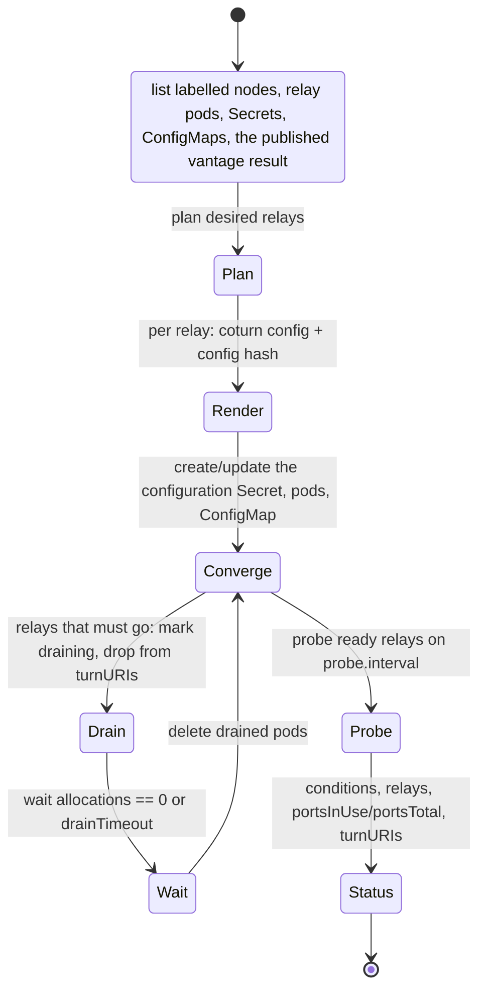

# Architecture

Turnfleet turns a `TURNPool` into a set of TURN relays, each with its own public
relay identity. It keeps that set reachable, drained and observable.

## The problem it solves

A TURN allocation is a public `(IP, port)` pair. Peer traffic sent to that pair
must reach the exact process holding the allocation. Running N relays behind one
load-balanced public IP cannot guarantee that: a Service or a cloud L4 load
balancer decides per flow, and peer packets arrive from arbitrary source ports,
so the destination port does not pick the process that holds the allocation.
Adding replicas behind one address therefore adds processes without adding
*relay capacity*. Every pod reports healthy, so the failure is silent. Turnfleet
replaces that with per-relay identities: one address plus a disjoint port range,
delivered without a load balancer. See `docs/adr/0001-addressing-modes.md` and
`docs/adr/0003-service-port-ranges.md`.

## Data path

Relays run with `hostNetwork: true` on nodes labelled
`turnfleet.hzmi.dev/relay-node=true` and bind their listener ports and relay
port range directly on a node address. There is no Service, Ingress or cloud
load balancer in the relay data path (ADR 3, ADR 4). Relays that share an address
(PartitionedIP) each get their own listener port: `spec.listeners[].port` plus
the relay's slot on its node. A listening socket binds once per address
(ADR 9). `PodIP` is the one mode that does not use the host's network: its relay
address belongs to the pod, on the default network or on a Multus attachment.
That is what makes the mode work on clusters whose nodes have no routable
address of their own (ADR 18).

## Components

| Component | Responsibility |
| --- | --- |
| `api/v1alpha1` | `TURNPool` spec and status. No logic. |
| `internal/relay.Planner` | Computes the desired relay set: one identity `(relayAddress, portRange)` per relay, disjoint within a pool, stable across restarts and failover. Implements the four addressing modes. |
| `internal/relay.Renderer` | Renders one relay's coturn configuration from the spec, the relay identity and the node address. Pure; golden-tested. |
| `internal/probe` | A real TURN `Allocate` (plus optional `CreatePermission`/`Send` round trip) against a relay listener on `pion/turn`, asserting the relayed address and range. |
| `internal/vantage` | The result a vantage runner publishes and where it publishes it: the `<pool>-vantage` ConfigMap, its labels and its JSON payload. |
| `internal/metrics` | `turnfleet_` collectors and the coturn scrape/parse helpers. |
| `internal/controller` | Reconciles a `TURNPool`: planner + renderer + relay pods + the configuration Secret + `<pool>-turn-uris` ConfigMap + status. Runs the drain state machine, the rolling config-hash update and the periodic probe. |
| `internal/webhook/v1alpha1` | Defaulting, validation, immutability, mode-specific rules. |
| `cmd/turnfleet-probe` | The same probe as a CLI with JSON output, so the check can run from outside the cluster. With `--uris-configmap`/`--publish-configmap` it is also the vantage runner: it probes every URI the pool publishes and writes the result where the controller reads it. |
| `config/` | The kustomize manifests for the controller: `config/default` runs it without admission webhooks, `config/with-webhook` adds them and their cert-manager certificates. Source of truth for what the controller is deployed as. |
| `charts/turnfleet` | The Helm chart for the same controller, for a consumer who does not want to run kustomize. It contains the CRDs, RBAC, the manager, the metrics Service and, opt-in, the webhooks. It never templates relays: relay pods come from the planner, and nothing in the relay data path goes through it. `make helm-drift` renders the chart and `config/` and fails on drift. A release publishes it as an OCI artifact, `oci://ghcr.io/hazmi35/turnfleet-chart/turnfleet`, at the release's version. It is signed keyless at its digest the way the released images are, so a consumer installs it without a checkout. |
| `config/vantage` | The runner manifest: a CronJob, its ServiceAccount, its Role and RoleBinding. It is not part of `config/default`: a runner is per pool and the operator does not schedule it. |

## Reconcile flow

* **Relay identity and naming.** A relay's identity is
  `(relayAddress, portRange)`, and its pod name is
  `<pool>-relay-<5-char hash of the identity>`. The same identity always maps
  to the same pod, so a controller restart or failover does not shuffle relays.
* **Rollout.** The rendered config, the object it is read from and the
  referenced Secret are hashed into the pod's
  `turnfleet.hzmi.dev/config-hash` annotation. A change rolls the relays
  **one at a time**, each with drain, so capacity loss is bounded to one relay.
* **Drain.** Draining relays are removed from `turnURIs` and from the
  `<pool>-turn-uris` ConfigMap *before* the pod goes away. Then readiness fails,
  and the controller waits for the allocation count to reach zero or for
  `spec.drainTimeout`. The finalizer `turnfleet.hzmi.dev/drain` runs the same
  sequence for pool deletion. See `docs/adr/0006-drain-semantics.md`.
* **`turnURIs`.** These list only ready, non-draining relays, mirrored into the
  `<pool>-turn-uris` ConfigMap. The credential issuer therefore hands out
  per-relay URIs, and never a URI for a relay that is saturated or going away.
* **Cross-pool identity check.** The pass compares the relays it planned with
  the identities every other pool reports in `status.relays[]`. An address held
  by both with overlapping ports is reported on each pool as `AddressConflict`
  and `Degraded`. Disjoint ranges on one address stay legal. A pool whose held
  identities change wakes the pools sharing its addresses, so the pool that did
  not change clears its condition. See
  `docs/adr/0012-cross-pool-address-conflict.md`.
* **Vantage result.** A runner publishes its pass over `<pool>-turn-uris` into
  the `<pool>-vantage` ConfigMap. The controller watches ConfigMaps by label and
  reads it every pass. The result is the only input to `ReachableFromVantage`.
  The in-cluster probe is not an input to it at all. See
  `docs/adr/0015-vantage-result-delivery.md`.

## Status and conditions

| Condition | Polarity | Meaning |
| --- | --- | --- |
| `Ready` | normal-true | The desired number of relays exist, are ready and non-draining. |
| `ProbeSucceeded` | normal-true | Every ready relay last probed successfully. |
| `CapacityPressure` | abnormal-true | A relay is near or at its port limit (`portsInUse`/`portsTotal`), or a probe observed error 508. |
| `AddressConflict` | abnormal-true | A relay this pool holds shares its address and ports with a relay of another pool. Disjoint ranges on a shared address are legal. |
| `ReachableFromVantage` | normal-true | Every listener URI the pool publishes answered a TURN `Allocate` where the vantage runner ran. False when one did not. Unknown while nothing current has been published: nothing at all, an unreadable payload, or a result older than 15 minutes. |
| `Degraded` | abnormal-true | Fewer relays than desired, a relay failing to converge, a relay identity that overlaps another pool's, or a vantage point that cannot reach the relays. |

`ReachableFromVantage` is a separate condition on purpose. `Ready` and
`ProbeSucceeded` describe what the controller sees from inside the cluster. A
relay can be perfectly healthy there while no peer can reach it: hairpin NAT,
a firewall in front of the relay node, or a NAT mapping that is not 1:1. The
vantage condition reports what a runner saw and takes no part in the others. A
passing in-cluster probe therefore cannot clear a failing observation.

`status.relays[]` carries the per-relay facts: `relayAddress`, `portRange`,
`ready`, `draining`, `allocations`, `portsInUse`, `portsTotal` and
`lastProbe{time,succeeded,latencyMillis,message}`. The API has no floats:
consumers compute the ratio themselves.

## Metrics

Every `turnfleet_` metric carries exactly `namespace`, `pool` and `relay`. Those
labels name the relay identity, never the whole object.
`turnfleet_relay_ports_total` is the capacity number; the pod count is not.

| Metric | Type | Source |
| --- | --- | --- |
| `turnfleet_relay_allocations` | gauge | coturn's own endpoint (`turn_total_allocations`, summed over socket types) |
| `turnfleet_relay_ports_in_use` | gauge | the same scrape; one allocation holds one port |
| `turnfleet_relay_ports_total` | gauge | the planned relay identity: the ports that relay owns |
| `turnfleet_allocation_failures_total{code}` | counter | allocations the probe observed failing, by TURN error code (ADR 5) |
| `turnfleet_probe_success` | gauge (1/0) | the last `Allocate` probe of that relay |
| `turnfleet_probe_duration_seconds` | gauge | the same probe |

The gauges are republished on every reconcile and dropped when a relay or pool
disappears. The failure counter is cumulative, so read it as a rate.
`docs/capacity-model.md` says what to watch when a pool runs out.

## Peer policy

A relay must never reach in-cluster or metadata addresses unless a pool
explicitly allows it. The default deny list (rendered as `--denied-peer-ip`)
covers RFC 1918, RFC 6598 (CGNAT), loopback, link-local including
`169.254.169.254`, benchmarking, multicast and the reserved ranges. It does not
enumerate cluster networks. The controller adds to that list whatever
`peerPolicy.deniedCIDRs` names. It also always denies two more sets of
addresses: the pod CIDRs it observes on the relay nodes, and every CIDR passed
on `--cluster-cidrs`. A cluster whose pod or service network is not RFC 1918 is
still denied. `allowedCIDRs` emits `--allowed-peer-ip` entries. The deny list is
what stops a relay from being turned into an SSRF pivot into the cluster (see
the e2e peer-policy case).

A pool that declares no `peerPolicy`, or an empty `deniedCIDRs` list, gets that
default. The defaulting webhook applies it. The controller also applies it,
because `config/default` runs without admission webhooks and a spec that
arrives from there has been defaulted by nobody. A pool that declares its own
list gets that list, and the default is not added to it. The controller still
adds the cluster CIDRs above.

## What is deliberately not here

The full list, including what each omission costs operationally, is in
`docs/limitations.md`.

* The direct/STUN path, signalling, and the credential-issuing endpoint are out
  of scope. Turnfleet only consumes the shared HMAC secret the issuer uses.
* No Service/LoadBalancer exposure, no ingress controller. The controller is
  installed with kustomize (`config/`) or with the Helm chart
  (`charts/turnfleet`). Both are the same controller, and neither is in the
  relay data path.
