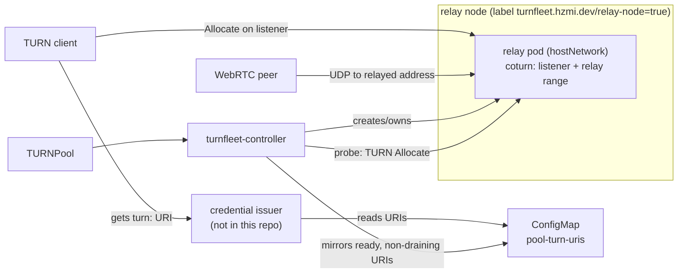
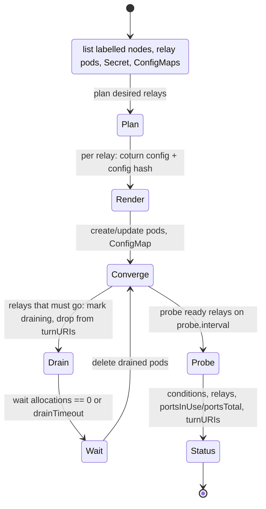

# Architecture

Turnfleet turns a `TURNPool` into a set of TURN relays, each with its own public
relay identity, and keeps that set reachable, drained and observable.

## The problem it solves

A TURN allocation is a public `(IP, port)` pair. Peer traffic sent to that pair
must reach the exact process holding the allocation. Running N relays behind one
load-balanced public IP cannot guarantee that: an L4 load balancer hashes on the
5-tuple, and a peer's source port is arbitrary. Adding replicas behind one
address therefore adds processes without adding *relay capacity*, while every
pod reports healthy — the failure is silent. Turnfleet replaces that with
per-relay identities: one address plus a disjoint port range, delivered without
a load balancer. See `docs/adr/0001-addressing-modes.md` and
`docs/adr/0003-service-port-ranges.md`.

## Data path

Relays run with `hostNetwork: true` on nodes labelled
`turnfleet.hzmi.dev/relay-node=true` and bind their listener ports and relay
port range directly on a node address. There is no Service, Ingress or cloud
load balancer in the relay data path (ADR 3, ADR 4). Relays that share an address
(PartitionedIP) each get their own listener port — `spec.listeners[].port` plus
the relay's slot on its node — because a listening socket binds once per address
(ADR 9).

## Components

| Component | Responsibility |
| --- | --- |
| `api/v1alpha1` | `TURNPool` spec and status. No logic. |
| `internal/relay.Planner` | Computes the desired relay set: one identity `(relayAddress, portRange)` per relay, disjoint within a pool, stable across restarts and failover. Implements the three addressing modes. |
| `internal/relay.Renderer` | Renders one relay's coturn configuration from the spec, the relay identity and the node address. Pure; golden-tested. |
| `internal/probe` | A real TURN `Allocate` (plus optional `CreatePermission`/`Send` round trip) against a relay listener on `pion/turn`, asserting the relayed address and range. |
| `internal/metrics` | `turnfleet_` collectors and the coturn scrape/parse helpers. |
| `internal/controller` | Reconciles a `TURNPool`: planner + renderer + relay pods + config ConfigMap + `<pool>-turn-uris` ConfigMap + status; runs the drain state machine, the rolling config-hash update and the periodic probe. |
| `internal/webhook/v1alpha1` | Defaulting, validation, immutability, mode-specific rules. |
| `cmd/turnfleet-probe` | The same probe as a CLI with JSON output, so the check can run from outside the cluster. |

## Reconcile flow

* **Relay identity and naming.** `(relayAddress, portRange)`; the pod name is
  `<pool>-relay-<5-char hash of the identity>`, so the same identity always maps
  to the same pod and a controller restart or failover does not shuffle relays.
* **Rollout.** The rendered config and the referenced Secret are hashed into the
  pod's `turnfleet.hzmi.dev/config-hash` annotation. A change rolls the relays
  **one at a time**, each with drain, so capacity loss is bounded to one relay.
* **Drain.** Draining relays are removed from `turnURIs` and from the
  `<pool>-turn-uris` ConfigMap *before* the pod goes away, then readiness fails,
  then the controller waits for the allocation count to reach zero or for
  `spec.drainTimeout`. The finalizer `turnfleet.hzmi.dev/drain` runs the same
  sequence for pool deletion. See `docs/adr/0006-drain-semantics.md`.
* **`turnURIs`.** Only ready, non-draining relays, mirrored into the
  `<pool>-turn-uris` ConfigMap so the credential issuer hands out per-relay
  URIs (and never a URI for a relay that is saturated or going away).

## Status and conditions

| Condition | Polarity | Meaning |
| --- | --- | --- |
| `Ready` | normal-true | The desired number of relays exist, are ready and non-draining. |
| `ProbeSucceeded` | normal-true | Every ready relay last probed successfully. |
| `CapacityPressure` | abnormal-true | A relay is near or at its port limit (`portsInUse`/`portsTotal`), or a probe observed error 508. |
| `Degraded` | abnormal-true | Fewer relays than desired, or a relay is failing to converge. |

`status.relays[]` carries per-relay truth: `relayAddress`, `portRange`,
`ready`, `draining`, `allocations`, `portsInUse`, `portsTotal` and
`lastProbe{time,succeeded,latencyMillis,message}`. The API has no floats:
consumers compute the ratio themselves.

## Metrics

Every `turnfleet_` metric carries exactly `namespace`, `pool` and `relay` — the
relay identity, never the whole object. `turnfleet_relay_ports_total` is the
capacity number; the pod count is not.

| Metric | Type | Source |
| --- | --- | --- |
| `turnfleet_relay_allocations` | gauge | coturn's own endpoint (`turn_total_allocations`, summed over socket types) |
| `turnfleet_relay_ports_in_use` | gauge | the same scrape; one allocation holds one port |
| `turnfleet_relay_ports_total` | gauge | the planned relay identity — the ports that relay owns |
| `turnfleet_allocation_failures_total{code}` | counter | allocations the probe observed failing, by TURN error code (ADR 5) |
| `turnfleet_probe_success` | gauge (1/0) | the last `Allocate` probe of that relay |
| `turnfleet_probe_duration_seconds` | gauge | the same probe |

The gauges are republished on every reconcile and dropped when a relay or pool
disappears; the failure counter is cumulative, so read it as a rate.
`docs/capacity-model.md` says what to watch when a pool runs out.

## Peer policy

A relay must never reach in-cluster or metadata addresses unless a pool
explicitly allows it. The default deny list (rendered as `--denied-peer-ip`)
covers RFC 1918, RFC 6598 (CGNAT), loopback, link-local including
`169.254.169.254`, and the cluster pod and service CIDRs. `allowedCIDRs` emits
`--allowed-peer-ip` entries. This is what stops a relay from being turned into
an SSRF pivot into the cluster (see the e2e peer-policy case).

## What is deliberately not here

The full list, including what each omission costs operationally, is in
`docs/limitations.md`.

* The direct/STUN path, signalling, and the credential-issuing endpoint are out
  of scope. Turnfleet only consumes the shared HMAC secret the issuer uses.
* No Service/LoadBalancer exposure, no ingress controller, no Helm chart (yet —
  tracked in #8).
